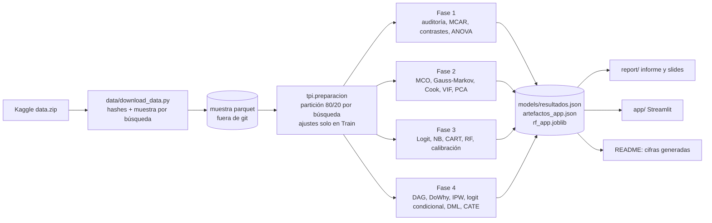
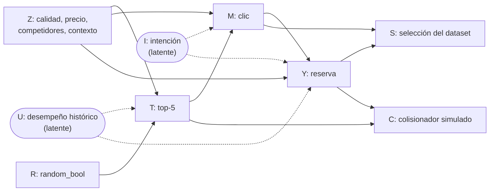

# Retorno causal de un algoritmo de recomendación

[](https://github.com/verolopezmar/TPI_Estadistica-avanzada-/actions/workflows/quality-gate.yml)


[](#deploy-en-streamlit-community-cloud)
[](#plan-b-contenedor-docker)

**TPI Decision Intelligence Capstone — Estadística Aplicada y Modelos de Regresión (EAyMR 2026)**
Pontificia Universidad Católica Argentina · Facultad de Ingeniería y Ciencias Agrarias ·
Prof. Ivan Gonzalo Vilaboa

> **¿El top-5 vende, o solo muestra lo que se vendería igual?** Medimos el efecto causal de que el
> recomendador de Expedia exponga un hotel en los primeros cinco lugares sobre su probabilidad de
> reserva, y lo contrastamos con un experimento natural: un subconjunto de búsquedas mostró los
> hoteles en orden aleatorio.

## Resultado principal

Las cifras de este bloque las genera `scripts/cifras_readme.py` desde `models/resultados.json`
(salida del notebook); `tests/test_cifras.py` falla si quedan desactualizadas.

<!-- cifras:inicio -->
| Estimación del efecto del top-5 sobre la reserva (OR dentro de la búsqueda) | OR | IC 95 % |
|---|---|---|
| **Orden aleatorio, ajustado (benchmark causal)** | **2,11** | [1,90; 2,35] |
| Orden del algoritmo, ajustado por todos los confusores observados | 3,38 | [3,24; 3,52] |
| Orden del algoritmo, comparación ingenua | 5,38 | [5,20; 5,58] |

- **El top-5 sí causa reservas.**
- **Con datos del algoritmo, el efecto se sobreestima aun después de ajustar:** cociente de OR
  1,60 (IC 95 % bootstrap por búsqueda
  [1,42; 1,80], 1000 réplicas); en
  diferencia de riesgos, cociente de efectos marginales 1,65
  [1,41; 1,98]. El ranker usa información que no
  observamos.
- **Para quién rinde el slot (orden aleatorio, LinearDML):**
  11,0 reservas incrementales cada
  1.000 exposiciones con hoteles baratos y bien ubicados, contra
  4,2 con hoteles caros y mal ubicados.
  Reasignar 1.000 exposiciones suma ≈ 1.530 USD con el gasto mediano.
<!-- cifras:fin -->

Detalle en el [informe](report/informe.pdf) y en el notebook (Fase 4).

## Entregables

| Entregable | Dónde |
|---|---|
| App (Diagnóstico + PCA, What-Is, What-If y copiloto bonus) | Enlace público: `<URL_APP>` (pendiente; ver [Deploy](#deploy-en-streamlit-community-cloud)) · código en [`app/`](app/) · plan B: [Docker](#plan-b-contenedor-docker) |
| Notebook maestro (Restart & Run All, con salidas) | [`notebooks/TP_Integrador_Final.ipynb`](notebooks/TP_Integrador_Final.ipynb) |
| Informe (paper a dos columnas, Quarto → PDF) | [`report/informe.pdf`](report/informe.pdf) · fuente [`report/informe.qmd`](report/informe.qmd) |
| Diapositivas de la defensa (PDF, 12 slides) | [`report/slides.pdf`](report/slides.pdf) |
| Bitácora de ingeniería (5 entradas) | [`BITACORA.md`](BITACORA.md) |
| Registro de uso de IA | [`docs/ia_log.md`](docs/ia_log.md) |
| Guion de la defensa y banco de preguntas | [`docs/defensa.md`](docs/defensa.md) |

## Pipeline



## DAG causal



Con el orden del algoritmo ($R = 0$), $Z$ bloquea los caminos traseros por $Z$ pero no
$T \leftarrow U \to Y$: Backdoor no se cumple. Con orden aleatorio ($R = 1$), el conjunto vacío
alcanza. El clic es mediador (no se ajusta) y $S$ y $C$ son colisionadores (no se condiciona en
ellos). 12 pruebas de d-separación en [`tests/test_dag.py`](tests/test_dag.py).

## Equipo

Verónica Ana López Marsico, Lucía Báez y Antonella Robiollio (roles Scrum: Project Lead & Scrum Master; Backend & ML / Causal; Frontend & UI/UX + QA). El análisis, las decisiones y las revisiones fueron del equipo en conjunto.

Uso de IA (Claude Code) documentado en [`docs/ia_log.md`](docs/ia_log.md) y en la Entrada 5 de la
[`BITACORA.md`](BITACORA.md).

## Estructura del repositorio

```
├── app/                    App Streamlit (app.py, logica.py, copiloto.py) y requirements fijados
├── data/                   Descarga reproducible y manifiestos con hashes (los datos no se versionan)
├── docs/                   Registro de IA, guion de defensa, enunciado y rúbrica
├── models/                 Solo agregados: resultados.json, artefactos_app.json, rf_app.joblib
├── notebooks/              TP_Integrador_Final.ipynb (notebook maestro, ejecutado)
├── report/                 Paper (informe.qmd → PDF), slides, figuras (fig_*.pdf) y bibliografía
├── scripts/cifras_readme.py  Regenera las cifras de este README desde resultados.json
├── src/tpi/                Lógica reutilizable: auditoría, inferencia, regresión, modelos, causal, DAG
├── tests/                  pytest: no-fuga, supuestos, estimadores con verdad conocida, app, datos
├── .github/                Quality Gate (CI) y plantilla de PR con checklist de QA
├── .streamlit/config.toml  Configuración de la app (Streamlit Cloud y Docker)
├── Dockerfile              Plan B de deploy de la app
└── BITACORA.md             Cuaderno de laboratorio (5 entradas)
```

## Reproducción paso a paso (Windows / PowerShell)

> Creá el entorno virtual **fuera** de carpetas sincronizadas (OneDrive, Dropbox, Google Drive):
> la sincronización bloquea y corrompe archivos del venv.

```powershell
# 1. Entorno (Python 3.11)
py -3.11 -m venv $HOME\.venvs\tpi-eaymr
& $HOME\.venvs\tpi-eaymr\Scripts\Activate.ps1
python -m pip install -r requirements.txt

# 2. Datos (requiere cuenta de Kaggle, aceptar las reglas de la competencia y `kaggle auth login`)
python data/download_data.py          # descarga data.zip, verifica hashes y genera la muestra

# 3. Calidad (Quality Gate local)
ruff check .
ruff format --check .
pytest -m leakage                     # no-fuga Train/Test
pytest                                # suite completa (incluye tests de datos si existe la muestra)

# 4. Notebook maestro (Restart & Run All) → figuras, resultados.json y artefactos de la app
python -m nbconvert --to notebook --execute --inplace notebooks/TP_Integrador_Final.ipynb
python scripts/cifras_readme.py       # cifras del README desde resultados.json

# 5. Informe y diapositivas
quarto render report/informe.qmd      # paper en PDF
quarto render report/slides.qmd       # PDF (beamer)

# 6. App local
streamlit run app/app.py
```

En Linux/macOS los pasos son los mismos, con `python3 -m venv` y `source .venv/bin/activate`.
Semilla global `SEED = 42` (`src/tpi/config.py`); α = 0,05 fijado a priori. Detalle de los datos y
del plan B de datos (Online Shoppers, CC BY 4.0) en [`data/README.md`](data/README.md).

## Deploy en Streamlit Community Cloud

La app solo necesita lo versionado: `app/`, `models/` (artefactos agregados y RF compacto) y
`.streamlit/config.toml`. No lee datos ni reentrena: carga JSON y joblib al iniciar.

1. Entrar a <https://share.streamlit.io> con la cuenta de GitHub y autorizar el acceso al repo.
2. **Create app** → *Deploy a public app from GitHub*:
   - **Repository:** `verolopezmar/TPI_Estadistica-avanzada-`
   - **Branch:** `main`
   - **Main file path:** `app/app.py`
   - **App URL:** por ejemplo `tpi-eaymr-top5`.
3. **Advanced settings** → **Python version: 3.11**. Opcional (copiloto, bonus): en **Secrets**,
   `ANTHROPIC_API_KEY = "..."`. Sin la clave, la pestaña del copiloto queda desactivada y el resto
   funciona.
4. **Deploy.** Streamlit Cloud instala `app/requirements.txt` (el que está junto a `app.py`, mínimo
   y con las mismas versiones con que se serializó el modelo).

## Plan B: contenedor Docker

```bash
docker build -t tpi-eaymr-app .
docker run --rm -p 8501:8501 tpi-eaymr-app            # http://localhost:8501
docker run --rm -p 8501:8501 -e ANTHROPIC_API_KEY=... tpi-eaymr-app   # con copiloto
```

La imagen (`python:3.11.9-slim`, usuario sin privilegios, healthcheck en `/_stcore/health`) copia
solo `app/`, `models/` y `.streamlit/`. Respeta la variable `PORT`, así que sirve también para
Render o Hugging Face Spaces. El CI construye la imagen en cada PR.

## Confidencialidad de los datos

Las reglas de la competencia declaran confidenciales los datos y los "resulting model parameters".
Decisión del equipo (12/11/2026): seguir con Expedia con mitigaciones verificadas por tests.

- Ningún archivo de datos en el repo (`tests/test_confidencialidad.py`).
- El crudo queda fuera del repo y de OneDrive.
- La app solo usa agregados con supresión de celdas menores a 10 filas, y un Random Forest con
  hojas de al menos 100 filas (`tests/test_app.py`).

El riesgo residual está documentado en la BITÁCORA (Entradas 1 y 4).

## Flujo de trabajo

Ramas por fase → Pull Request a `main` con el checklist de la plantilla → CI (Quality Gate:
`ruff`, `pytest -m leakage`, `pytest`, build de Docker) → veredicto de QA `[APROBADO]` o
`[BLOQUEADO]` en el PR → merge con "Create a merge commit". Issues agrupados en un milestone por
fase.

## Referencias principales

Pearl (2009), *Causality*; Chernozhukov et al. (2018), *Double/Debiased Machine Learning*; Sharma y
Kiciman (2020), *DoWhy*; Battocchi et al. (2019), *EconML*; Wager y Athey (2018), *Causal Forests*;
Liu et al. (2013) y la competencia de Kaggle *Personalize Expedia Hotel Searches — ICDM 2013*.
Bibliografía completa en [`report/referencias.bib`](report/referencias.bib).
