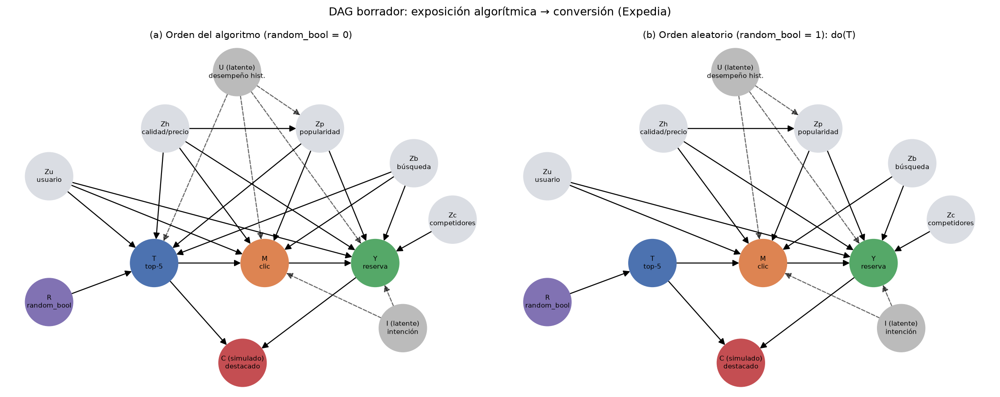

# DAG causal — borrador para revisión (Fase 0)

> Para: Lucía (Backend & ML/Causal) y Verónica (Lead). Código: `src/tpi/dag.py`.
> Propiedades verificadas por d-separación: `tests/test_dag.py` (9 tests en verde).
> Todavía **sin datos**: los arcos son supuestos de dominio que la Fase 1 puede contradecir.

## 1. Pregunta y estimando

Unidad: par búsqueda × hotel. Para el hotel *i* de la búsqueda *s*:

- $T_{is} = 1\{\text{position}_{is} \le 5\}$: el recomendador lo expone en el top-5.
- $Y_{is}$: `booking_bool` (conversión). Secundario: `gross_bookings_usd` (gasto).
- Resultados potenciales $Y_{is}(1), Y_{is}(0)$: reserva si el hotel estuviera / no estuviera
  en el top-5.
- Estimando principal: $\tau = \mathbb{E}[Y(1) - Y(0)]$ (ATE de la exposición). Heterogeneidad:
  $\tau(x) = \mathbb{E}[Y(1) - Y(0) \mid X = x]$ por perfil de hotel y de usuario.

**Por qué top-5 y no `position` continua.** El binario facilita IPW y CATE y responde a una
decisión de negocio ("¿vale la pena darle a este hotel un slot premium?"). La posición continua
queda como análisis de sensibilidad (curva dosis-respuesta), porque el umbral 5 es arbitrario.
**A decidir con Lucía.**

## 2. Arcos, uno por uno

| Arco | Justificación | Confianza |
|---|---|---|
| R → T | `random_bool` define el mecanismo de asignación: con R = 1 la posición es aleatoria. | Alta (la verifica `test_random_bool_*`) |
| Zh → T | Un ranker de hoteles usa estrellas, reseñas, ubicación y precio. | Alta |
| Zp → T | La popularidad previa (`prop_log_historical_price`, `srch_query_affinity_score`) es una señal típica de un ranker. | Media |
| Zb → T | La personalización por contexto (noches, anticipación, adultos/niños) cambia el orden. | Media |
| Zu → T | La personalización por historial del usuario: es la "autoselección de recurrentes" del tema. | Media |
| U → T | El ranker usa el desempeño histórico del hotel en Expedia (CTR, conversión), que **no observamos**. | Alta como amenaza |
| T → M | La posición alta aumenta la probabilidad de clic (sesgo de posición, atención). | Alta |
| M → Y | No hay reserva sin clic (regla dura del contrato de datos). | Alta |
| T → Y directo | **Ausente:** toda la exposición pasa por el clic. Si la Fase 1 encuentra reservas sin clic, se revisa. | A verificar |
| Zh, Zp, Zb, Zu, U → M, Y | La calidad, el precio, el contexto y el historial afectan el clic y la reserva por sí mismos. | Alta |
| Zc → Y | Si el competidor es más barato, el usuario se va a reservar allá. No sabemos si el ranker lo usa (Zc → T no está). | Media |
| I → M, I → Y | La intención de compra de la sesión (latente) causa el clic y la reserva, pero no la posición. | Alta |
| Zh → Zp, U → Zp | La popularidad previa es en parte consecuencia de la calidad y del desempeño histórico. | Media |
| T → C ← Y | Colisionador **simulado** en la Fase 4: "aparece en el reporte de destacados" si fue expuesto o vendió. | Por construcción |

## 3. Identificación (lo que demuestran los tests)

1. **Orden aleatorio (R = 1).** La intervención corta todos los arcos que entran a T salvo
   R → T, así que $Y(t) \perp T$ y $\tau$ se identifica **sin ajuste**:
   $\hat\tau_{\text{exp}} = \bar Y_{T=1} - \bar Y_{T=0}$. Es nuestro **benchmark**.
2. **Orden del algoritmo (R = 0).** El conjunto $Z = \{Zh, Zp, Zb, Zu\}$ bloquea los caminos
   T ← Z → Y, pero **no** T ← U → Y. Con U en el grafo, Backdoor no se cumple
   (`test_algoritmo_ajustar_z_observado_no_alcanza_si_existe_u`).
   - Si no existiera U (supuesto de ignorabilidad condicional), $\hat\tau_{\text{bd}}$ debería
     coincidir con $\hat\tau_{\text{exp}}$.
   - **Contraste empírico del supuesto Backdoor:** la brecha
     $\hat\tau_{\text{bd}} - \hat\tau_{\text{exp}}$ estima el sesgo por confusión no observada.
     Las refutaciones de DoWhy (y la de causa común no observada) dicen cuán grande tendría que
     ser U para explicarla.
3. **Trampa del mediador.** Ajustar por M (clic) viola Backdoor porque M desciende de T: bloquea
   el único canal T → M → Y, y el efecto estimado debería caer a ≈ 0.
4. **El clic es además colisionador:** T → M ← I. Condicionar en M abre T – I – Y y
   **asocia la exposición con la intención de compra** (`test_el_clic_es_ademas_colisionador...`).
   Es la trampa típica de "analicemos solo a los que hicieron clic": mezcla la trampa del
   mediador con un sesgo de Berkson. Material fuerte para la defensa.
5. **Trampa del colisionador C.** Con R = 1, T y Zh son independientes. Condicionar en C los
   vuelve dependientes (sesgo de Berkson), así que la estimación se sesga aunque la asignación
   haya sido aleatoria.

## 4. Supuestos y amenazas a la validez interna

- **SUTVA / interferencia.** Los hoteles de una lista compiten por el mismo slot: poner a uno
  en el top-5 desplaza a otro, y una reserva en una lista suele excluir a las demás. El
  estimando es "efecto de la posición dada la competencia de esa lista", no un efecto aislado.
  Mitigación: errores robustos por clúster (`srch_id`) y particiones agrupadas por búsqueda.
- **Positividad.** En R = 0 hay hoteles de baja calidad que casi nunca llegan al top-5:
  revisar el overlap del propensity score y recortarlo (trimming) si hace falta.
- **Validez externa del benchmark.** Las búsquedas con R = 1 pueden diferir de las R = 0
  (site, país, período). Hay que comparar la distribución de Z entre ambos estratos antes de
  usar una como benchmark de la otra.
- **Composición de la lista.** En R = 0 el top-5 tiene mejores vecinos. Si queremos controlar
  "calidad relativa en la lista", hay que construir features relativas a la búsqueda.
- **Precio por noche vs. por estadía.** Si `price_usd` mezcla unidades, Zh tiene error de
  medición (se audita en la Fase 1).

## 5. Preguntas abiertas para Lucía

1. ¿T binaria (top-5) o continua (posición)? ¿Top-3 / top-5 / top-10 como sensibilidad?
2. ¿Y principal = conversión (`booking_bool`) o gasto (`gross_bookings_usd`, solo condicional
   a reservar, lo que es otra trampa de selección)? Propuesta: conversión como principal y
   gasto esperado $=\Pr(\text{reserva}) \times \mathbb{E}[\text{gasto} \mid \text{reserva}]$
   para traducir a dólares.
3. ¿Zc entra como confusor (Zc → T) o solo como predictor de Y?
4. ¿Algún colisionador **natural** en los datos que podamos usar en lugar del simulado?
