```{python}
#| label: setup
import json
from pathlib import Path

import pandas as pd

R = json.loads(Path("../models/resultados.json").read_text("utf-8"))
F1, F2, F3, F4 = R["fase1"], R["fase2"], R["fase3"], R["fase4"]


def n(x, d=3):
    """Número con coma decimal y punto de miles."""
    s = f"{x:,.{d}f}"
    return s.replace(",", "X").replace(".", ",").replace("X", ".")


def pv(p):
    if p == 0:
        return "p < 10⁻³⁰⁰"
    if p >= 0.001:
        return f"p = {n(p, 3)}"
    mant, exp = f"{p:.2e}".split("e")
    sup = str.maketrans("-0123456789", "⁻⁰¹²³⁴⁵⁶⁷⁸⁹")
    return f"p = {mant.replace('.', ',')}·10{str(int(exp)).translate(sup)}"


def pct(x, d=1):
    return n(100 * x, d) + " %"


def ic(lo, hi, d=3):
    return f"[{n(lo, d)}; {n(hi, d)}]"


def md(df):
    """DataFrame -> tabla Markdown de pipes (Pandoc la ajusta al ancho de página)."""
    from IPython.display import Markdown

    def celda(v):
        return str(v).replace("|", "\\|")

    cab = "| " + " | ".join([celda(df.index.name or " ")] + [celda(c) for c in df.columns]) + " |"
    sep = "|" + "|".join([":---"] + ["---:"] * len(df.columns)) + "|"
    filas = ["| " + " | ".join([celda(i)] + [celda(v) for v in fila]) + " |" for i, fila in zip(df.index, df.to_numpy())]
    return Markdown("\n".join([cab, sep, *filas]))


def tabla(df, d=4):
    """Tabla con coma decimal, como Markdown."""
    return md(df.apply(lambda c: c.map(lambda v: n(v, d) if isinstance(v, float) else v)))


c1, c2, c2b, an = F1["contraste1"], F1["contraste2"], F1["contraste2_mw"], F1["anova"]
orb, ora, ori = F4["or_benchmark"], F4["or_ajustado_R0"], F4["or_ingenuo_R0"]
OR_TAB = F4["or_intra"]
ic_bench = OR_TAB["R = 1 (aleatorio) | ajustado por Z"]["OR IC95"]
mejor = F3["mejor"]
R4 = F4["robustez"]
RB = R4["bootstrap"]
TR = R4["tabla"]
EMB = F4["embudo"]
LT = F1["little"]
OV = F4["overlap"]
IPW = F4["ipw"]
SEG = F4["cate_segmentos"]
NEG = F4["negocio_segmentos"]
REA = F4["reasignacion"]
ESC = F4["escenarios"]
d0, d1 = F4["dml"]["R = 0"], F4["dml"]["R = 1"]
ipw0 = IPW["R = 0 (algoritmo) | IPW Hájek"]
ipw0r = IPW["R = 0 (algoritmo) | IPW Hájek, excluye ê fuera de [0,01; 0,99]"]
ov0, ov1 = OV["R = 0 (algoritmo)"], OV["R = 1 (aleatorio)"]
imp = F3["importancia"]
top_perm = max(imp, key=lambda k: imp[k]["Permutación (ΔPR-AUC)"])
fe1 = OR_TAB["R = 1 (aleatorio) | ajustado por Z"]
```

::: {.content-visible when-format="html"}
**Pontificia Universidad Católica Argentina** — Facultad de Ingeniería y Ciencias Agrarias ·
Estadística Aplicada y Modelos de Regresión (EAyMR 2026) · Trabajo Práctico Integrador: Decision
Intelligence Capstone · Profesor titular: Prof. Ivan Gonzalo Vilaboa
:::

# Resumen ejecutivo {.unnumbered}

- **El top-5 causa reservas, pero bastante menos de lo que sugieren los datos del algoritmo.** Con
  orden aleatorio, estar en el top-5 multiplica por `{python} n(orb, 2)` las chances de que un hotel
  sea el reservado de su lista (OR intra-búsqueda ajustado, IC 95 % `{python} ic(*ic_bench, 2)`). Con
  el orden del algoritmo, la comparación ingenua da `{python} n(ori, 2)` y el ajuste por los
  confusores observados la baja a `{python} n(ora, 2)`.
- **El ajuste por lo observable no alcanza.** Explica el `{python} n(F4["pct_explicado_Z"], 0)` % de
  la brecha en log-odds. El OR observacional ajustado supera al benchmark en un factor
  `{python} n(RB["cociente_OR"]["mediana"], 2)` (IC 95 % bootstrap por búsqueda
  `{python} ic(RB["cociente_OR"]["IC95_inf"], RB["cociente_OR"]["IC95_sup"], 2)`,
  `{python} R4["B"]` réplicas); en diferencia de riesgos, que es colapsable, el factor es
  `{python} n(RB["cociente_AME"]["mediana"], 2)`. El ranker usa información que no observamos.
- **Predecir no es intervenir.** El mejor modelo predictivo (`{python} mejor`, PR-AUC
  `{python} n(F3["test"][mejor]["PR_AUC"], 3)` con una prevalencia del 2 %) usa la posición como
  variable principal, pero buena parte de ese poder predictivo es selección del algoritmo.
- **Para quién rinde el slot.** Con orden aleatorio, el efecto por exposición es
  `{python} n(NEG["barato y bien ubicado"]["reservas incrementales / 1.000"], 1)` reservas cada 1.000
  exposiciones para hoteles baratos y bien ubicados, contra
  `{python} n(NEG["caro y mal ubicado"]["reservas incrementales / 1.000"], 1)` para hoteles caros y
  mal ubicados. Reasignar 1.000 exposiciones del segundo grupo al primero suma
  `{python} n(REA["reservas_por_1000"], 1)` reservas (≈ `{python} n(REA["usd_por_1000"], 0)` USD con
  el gasto mediano).
- **Decisión.** Valuar el slot premium con el efecto causal, no con la tasa observada (el dato del
  algoritmo sobrevalúa el OR en `{python} pct(ora / orb - 1, 0)`), priorizar la exposición donde el
  CATE es mayor y mantener una fracción de tráfico con orden aleatorio como auditoría permanente.

# Introducción y preguntas de negocio

Un buscador de hoteles muestra alrededor de 25 resultados por búsqueda, pero la atención del
usuario se concentra en los primeros. Los slots superiores son un recurso escaso de suma cero:
subir un hotel baja a otro. El recomendador decide quién los ocupa y, a la vez, suele elegir
hoteles que se venderían igual (mejor ubicados, más baratos para la búsqueda, con buena
reputación). La pregunta operativa es si el slot **causa** ventas o solo las **predice**: de eso
depende cuánto vale un slot premium (publicidad, comisiones de posicionamiento) y a quién conviene
asignarlo.

**Preguntas de valor.**

1. ¿Cuál es el efecto causal de la exposición en el top-5 sobre la reserva (ATE y CATE)?
2. ¿Cuánto sesgo introduce estimarlo con el orden del algoritmo en lugar del orden aleatorio?
3. ¿El efecto pasa entero por el clic?
4. ¿Para qué hoteles rinde más el slot?
5. *(Propias)* ¿Qué tan aleatorio es el orden aleatorio? ¿Cómo condiciona la selección del dataset
   lo que se puede estimar?

**Restricciones reales del sistema.** Los datos son confidenciales según las reglas de la
competencia [@kaggle2013expedia]: ningún archivo de datos está en el repositorio y la aplicación usa
solo agregados. El dataset incluye solo búsquedas con al menos un clic y, en el estrato del
algoritmo, sobremuestrea las compras (@sec-datos).

# Marco formal

Esta sección fija la notación, los estimandos y los supuestos **antes** de cualquier resultado.
Distinguimos parámetros poblacionales (letras griegas: $\beta$, $\mu$, $\tau$, $\psi$) de sus
estimadores ($\hat\beta$, $\bar x$, $\hat\tau$, $\hat\psi$).

## Unidades, variables y roles

La unidad de análisis es el par búsqueda × hotel $(s, i)$; la unidad independiente para la
inferencia es la búsqueda $s$, porque los hoteles de una lista comparten usuario, fecha y destino.

| Símbolo | Variable | Rol |
|---|---|---|
| $Y_{is}$ | `booking_bool` | Resultado: el hotel $i$ es el reservado en la búsqueda $s$ |
| $T_{is}$ | $1\{\texttt{position} \le 5\}$ | Tratamiento: exposición en el top-5 de la pantalla |
| $M_{is}$ | `click_bool` | Mediador (y colisionador con la intención $I$) |
| $Z$ | calidad y precio ($Z_h$), popularidad ($Z_p$), contexto ($Z_b$), usuario ($Z_u$), competidores ($Z_c$) | Confusores observados |
| $U$, $I$ | desempeño histórico del hotel en Expedia; intención de la sesión | Latentes |
| $R_s$ | `random_bool` | Mecanismo de asignación: 1 = orden aleatorio |
| $S_s$ | inclusión de la búsqueda en el dataset | Selección (descendiente de $M$ y, con $R=0$, de $Y$) |
| $C$ | "destacado en el reporte", simulado | Colisionador $T \to C \leftarrow Y$ para la trampa de Berkson |

: Variables y roles en el DAG. {#tbl-roles}

## Estimandos

Con resultados potenciales $Y_{is}(t)$, $t \in \{0, 1\}$:

$$
\tau = \mathbb{E}\big[Y(1) - Y(0)\big], \qquad
\tau(x) = \mathbb{E}\big[Y(1) - Y(0) \mid X = x\big], \qquad
\tau_S = \mathbb{E}\big[\tau(X) \mid X \in S\big].
$$ {#eq-estimandos}

Como el dataset está seleccionado sobre el clic y, en $R = 0$, sobre la compra, la escala absoluta
de $\tau$ no es comparable entre estratos. Por eso el estimando principal es relativo y dentro de la
búsqueda: el odds ratio condicional $\psi = e^{\gamma}$ del logit condicional [@mcfadden1974conditional]

$$
P\big(Y_{is} = 1 \mid \textstyle\sum_{j} Y_{js} = 1,\; T_s,\; Z_s\big)
  = \frac{\exp(\gamma\,T_{is} + Z_{is}^\top \delta)}{\sum_{j \in s} \exp(\gamma\,T_{js} + Z_{js}^\top \delta)},
$$ {#eq-clogit}

que condiciona en el número de reservas de la lista: el término de cada búsqueda (intención,
destino, fecha) se cancela, y $\psi$ no depende de cuántas listas con compra seleccionó el
proveedor (lógica de caso-control, @prentice1979casecontrol).

## Supuestos de identificación

1. **SUTVA.** El resultado de un hotel depende solo de su propia exposición. Es una aproximación:
   con slots de suma cero, subir a un hotel desplaza a otro (interferencia). Interpretamos $\tau$
   como "efecto dada la competencia de la lista".
2. **Positividad.** $0 < e(z) = P(T = 1 \mid Z = z) < 1$. Se verifica con la propensión estimada
   (@sec-overlap).
3. **Intercambiabilidad condicional (Backdoor).** $Y(t) \perp T \mid Z$. Con $R = 1$ el orden
   aleatorio la garantiza por diseño, salvo la asociación residual que documentamos. Con $R = 0$
   vale solo si $Z$ bloquea todo camino trasero; el DAG predice que $U$ lo impide, y el benchmark lo
   contrasta.

## Diseño muestral y plan experimental

- **Muestra.** De `{python} n(R["fase0"]["filas_train_csv"], 0)` filas y
  `{python} n(R["fase0"]["busquedas_train_csv"], 0)` búsquedas de `train.csv`
  [@liu2013expedia], tomamos `{python} n(R["fase0"]["muestra_busquedas"], 0)` búsquedas
  **completas** (`{python} n(R["fase0"]["muestra_filas"], 0)` filas), estratificadas por
  `random_bool` y con semilla fija. Se muestrea por búsqueda para no romper las listas.
- **Partición.** 80/20 agrupada por búsqueda (ninguna lista queda partida) y estratificada por
  `random_bool`; validación cruzada `StratifiedGroupKFold(5)` dentro de Train. La partición depende
  solo del identificador de búsqueda y de la semilla, así que se fija antes de transformar los datos:
  cercas de Tukey, cuantiles de winsorización y medianas de imputación se ajustan **solo con Train**
  (tests marcados `leakage` en el Quality Gate).
- **Nivel de significación y potencia.** Fijamos $\alpha = 0{,}05$ a priori. Con $n$ en miles, casi
  todo contraste rechaza; por eso reportamos, junto con cada p-valor, el tamaño de efecto y el
  **efecto mínimo detectable** con potencia $1 - \beta = 0{,}80$:
  $\text{MDE} = (z_{1-\alpha/2} + z_{1-\beta})\,\sqrt{1/n_1 + 1/n_2}$ en unidades de desvío.

# Datos y auditoría de calidad {#sec-datos}

```{python}
#| label: tbl-centinelas
#| tbl-cap: "Centinelas (0 = sin dato): distorsión antes y después de pasarlos a faltante."
cen = pd.DataFrame(F1["centinelas"]).T[["pct_filas", "media_antes", "media_despues", "desvio_antes", "desvio_despues", "sesgo_media_pct"]]
cen.columns = ["% filas", "media antes", "media después", "DE antes", "DE después", "sesgo de la media (%)"]
tabla(cen, 3)
```

**Hallazgos de la auditoría forense** (detalle en el notebook, 1.2):

- **Centinelas.** Tres variables codifican "sin dato" con 0 (@tbl-centinelas). El caso más grave es
  `prop_log_historical_price`: el 0 aparece en el
  `{python} n(F1["centinelas"]["prop_log_historical_price"]["pct_filas"], 1)` % de las filas y su
  desvío cae de `{python} n(F1["centinelas"]["prop_log_historical_price"]["desvio_antes"], 3)` a
  `{python} n(F1["centinelas"]["prop_log_historical_price"]["desvio_despues"], 3)` al tratarlo.
- **Desplazamiento de escala del precio.** El `{python} n(F1["escala_precio_pct"]["por_estadia"], 1)` %
  de las reservas de dos o más noches tiene el precio por estadía, no por noche, y la proporción varía
  entre sitios. Se neutraliza con el precio relativo a la mediana de la búsqueda.
- **Valores extremos.** `{python} n(F1["outliers_precio"]["filas"], 0)` filas
  (`{python} n(F1["outliers_precio"]["pct"], 3)` %) caen fuera de las cercas extremas de Tukey sobre
  el log del precio, `{python} ic(F1["outliers_precio"]["cerca_inf"], F1["outliers_precio"]["cerca_sup"], 2)` USD
  (ajustadas en Train), o a más de 10 veces la mediana de su
  búsqueda.
- **Slots estructurales.** Las posiciones `{python} ", ".join(str(s) for s in F1["slots_especiales"])`
  casi nunca están en el dataset: las ocupan listados que Kaggle no publica.
- **Selección del dataset.** Ninguna búsqueda tiene cero clics, y el 94 % de las búsquedas con orden
  del algoritmo tiene una reserva, contra el 13 % con orden aleatorio. Es el colisionador natural de
  la @sec-trampas.

```{python}
#| label: tbl-faltantes
#| tbl-cap: "Faltantes: porcentaje, mayor dependencia con variables observadas y tratamiento (medianas ajustadas solo con Train)."
mec = {
    "prop_location_score2": ("MAR", "mediana por país + indicador"),
    "orig_destination_distance": ("MAR", "mediana por par de países + indicador"),
    "prop_review_score": ("MNAR estructural", "mediana por estrellas + indicador"),
    "visitor_hist_starrating": ("MNAR estructural", "no se imputa (indicador)"),
    "srch_query_affinity_score": ("MNAR estructural", "no se imputa (indicador)"),
}
fal = pd.DataFrame(
    {
        "% faltante": [F1["faltantes_pct"][v] for v in mec],
        "máx. |efecto|": [F1["mcar_max_efecto"][v] for v in mec],
        "mecanismo": [m[0] for m in mec.values()],
        "tratamiento": [m[1] for m in mec.values()],
    },
    index=list(mec),
)
tabla(fal, 2)
```

**Mecanismo de los faltantes.** Sea $R_j = 1\{X_j \text{ falta}\}$. Bajo MCAR, $R_j$ es
independiente de toda variable observada. Lo contrastamos variable por variable (χ² o Mann-Whitney
con Bonferroni, y tamaño de efecto) y en forma conjunta con el test de Little
[@little1988mcar]: $d^2$ = `{python} n(LT["d2"], 1)` con `{python} LT["gl"]` gl,
`{python} pv(LT["p_valor"])` (`{python} LT["patrones"]` patrones de faltantes). **Se rechaza MCAR.**
Las variables con dependencia apreciable de lo observado se tratan como MAR (imputación por grupo
con indicador); las MNAR estructurales no se imputan, porque imputar un historial que no existe
inventaría información (@tbl-faltantes).

# Fase 1: inferencia clásica y ANOVA

**Contraste 1: sesgo de posición en el clic (pareado, orden aleatorio).** Para cada búsqueda
$s$ con $R = 1$, $D_s = \overline{\text{CTR}}_{\text{top-5}, s} - \overline{\text{CTR}}_{\text{resto}, s}$.
$H_0: \mu_D = 0$ frente a $H_1: \mu_D \neq 0$; t de Student pareado, con Wilcoxon de resguardo.

- *t*(`{python} n(c1["gl"], 0)`) = `{python} n(c1["valor"], 2)`, `{python} pv(c1["p_valor"])`;
  $\bar D$ = `{python} n(c1["diferencia"], 4)` (IC 95 % `{python} ic(*c1["ic95"], 4)`);
  $d_z$ = `{python} n(c1["efecto"], 3)`; Wilcoxon `{python} pv(c1["extra"]["wilcoxon_p"])`.
- **Se rechaza $H_0$.** La tasa de clic del top-5 es `{python} n(c1["ctr_top5"] / c1["ctr_resto"], 2)`
  veces la del resto. El MDE con $n$ = `{python} n(c1["n"][0], 0)` búsquedas es $d_z$ =
  `{python} n(c1["mde_dz"], 3)`, muy por debajo del efecto observado. Es el arco $T \to M$ del DAG.

**Contraste 2: gasto por reserva, usuarios recurrentes vs. nuevos (Welch).** Sobre el log del
gasto, $H_0: \mu_{\text{rec}} = \mu_{\text{nue}}$. Usamos Welch aunque Levene no rechaza, porque los
grupos están muy desbalanceados (`{python} n(c2["n"][0], 0)` vs. `{python} n(c2["n"][1], 0)`).

- *t*(`{python} n(c2["gl"], 1)`) = `{python} n(c2["valor"], 3)`, `{python} pv(c2["p_valor"])`;
  cociente de medias geométricas `{python} n(c2["cociente_geom"], 3)` (IC 95 %
  `{python} ic(*c2["ic_cociente"], 3)`); $g$ de Hedges = `{python} n(c2["efecto"], 3)`;
  Mann-Whitney `{python} pv(c2b["p_valor"])`.
- **No se rechaza $H_0$.** No es evidencia de igualdad: la muestra no distingue diferencias menores
  que $g$ = `{python} n(c2["mde_g"], 3)` (MDE con potencia 0,80).

**ANOVA de un factor: log del precio por noche según estrellas (4 grupos).**
$H_0: \mu_{1\text{-}2} = \mu_3 = \mu_4 = \mu_5$.

- **Normalidad.** Con $n$ grande, Shapiro-Wilk rechaza ante desvíos irrelevantes: su potencia
  tiende a 1 para cualquier alternativa fija, mientras que el estadístico F depende de las medias
  muestrales, cuya distribución se acerca a la normal por el TCL (la asimetría de $\bar x$ decae
  como $\gamma_1/\sqrt{n}$). Evaluamos asimetría, curtosis y Q-Q por grupo: asimetrías dentro de
  $[-1, 1]$ y colas algo pesadas (notebook, 1.8).
- **Homocedasticidad.** Levene (Brown-Forsythe) *F*(`{python} an["levene"]["gl"][0]`;
  `{python} n(an["levene"]["gl"][1], 0)`) = `{python} n(an["levene"]["valor"], 2)`,
  `{python} pv(an["levene"]["p_valor"])`: **se rechaza** la igualdad de varianzas.
- **Inferencia principal: ANOVA de Welch** [@welch1951anova]: *F*(`{python} n(an["welch"]["gl"][0], 0)`;
  `{python} n(an["welch"]["gl"][1], 1)`) = `{python} n(an["welch"]["valor"], 1)`,
  `{python} pv(an["welch"]["p_valor"])`, $\eta^2$ = `{python} n(an["welch"]["efecto"], 3)`.
  Kruskal-Wallis coincide: $H(3)$ = `{python} n(an["kruskal"]["valor"], 1)`,
  $\varepsilon^2$ = `{python} n(an["kruskal"]["efecto"], 3)`.
- **Post-hoc.** Games-Howell [@games1976posthoc] como principal (varianzas desiguales); Tukey HSD y
  Bonferroni como comparación: las tres coinciden en todos los pares. Un hotel de 5 estrellas cuesta
  `{python} n(F1["posthoc_cociente_5_vs_12"], 2)` veces uno de 1-2 estrellas (medias geométricas).

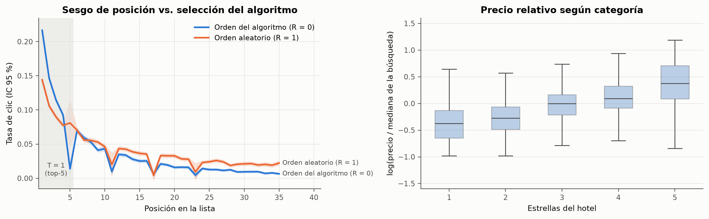{#fig-ctr}

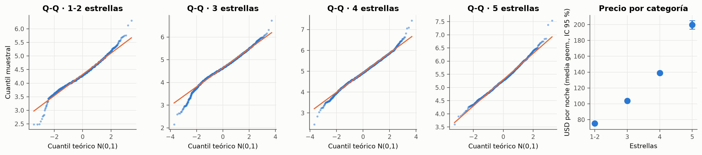{#fig-anova}

# Fase 2: Gauss-Markov y PCA

El modelo de referencia es $\log(\text{precio por noche}) = \beta_0 + \sum_{k} \beta_k X_k + \varepsilon$
sobre `{python} n(F2["mco"]["n"], 0)` reservas de Train. Estimado por MCO: $R^2$ =
`{python} n(F2["mco"]["r2"], 3)`, $R^2$ ajustado = `{python} n(F2["mco"]["r2_aj"], 3)`,
*F*(`{python} F2["mco"]["gl"][0]`; `{python} n(F2["mco"]["gl"][1], 0)`) = `{python} n(F2["mco"]["F"], 1)`.
La especificación ingenua sobre el precio crudo fracasa: $R^2$ = `{python} n(F2["ingenuo"]["r2"], 4)`,
con una sola observación de distancia de Cook `{python} n(F2["ingenuo"]["cook_max"], 3)` (> 0,5)
que domina el ajuste (BITÁCORA, Entrada 3).

| Supuesto | Prueba y resultado | Remediación |
|---|---|---|
| Homocedasticidad | Breusch-Pagan [@breusch1979bp] LM = `{python} n(F2["gauss_markov"]["bp_lm"], 1)` (gl `{python} F2["gauss_markov"]["bp_gl"]`), `{python} pv(F2["gauss_markov"]["bp_p"])`; White `{python} pv(F2["gauss_markov"]["white_p"])` | Errores HC3 [@mackinnon1985hc3] |
| Normalidad | Jarque-Bera = `{python} n(F2["gauss_markov"]["jb"], 1)`, `{python} pv(F2["gauss_markov"]["jb_p"])`; curtosis `{python} n(F2["gauss_markov"]["curtosis"], 2)` | TCL para t y F; Huber [@huber1964robust] de resguardo |
| Independencia | Durbin-Watson = `{python} n(F2["gauss_markov"]["durbin_watson"], 3)` (orden temporal) | Ninguna |
| Atípicos y apalancamiento | `{python} F2["influencia"]["outlier_y"]` con $\lvert r_i \rvert > 3$; `{python} F2["influencia"]["alto_leverage"]` con $h_{ii} > 2(p+1)/n$ | Se conservan: cola pesada real |
| Influyentes | `{python} F2["influencia"]["influyente_4n"]` con $D_i > 4/n$; `{python} F2["influencia"]["influyente_05"]` con $D_i > 0{,}5$ (máx. `{python} n(F2["influencia"]["cook_max"], 4)`) [@cook1977influence] | Huber coincide con MCO sin influyentes |
| Multicolinealidad | VIF máx. `{python} n(F2["vif_max_modelo"], 2)` (modelo) y `{python} n(F2["vif_max_ampliado"], 2)` (Fase 3) | Ninguna: ningún VIF supera 5 |

: Auditoría de Gauss-Markov del MCO de referencia. {#tbl-gm}

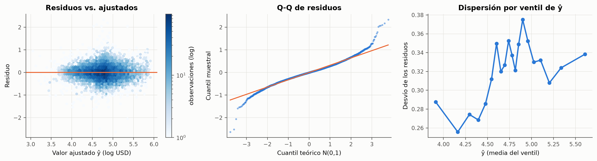{#fig-residuos}

**PCA sin fuga.** Estandarización y descomposición espectral se ajustan **solo con Train**; Test se
proyecta con la misma rotación. Kaiser ($\lambda_k > 1$) retiene `{python} F2["pca"]["n_kaiser"]`
componentes (`{python} n(F2["pca"]["pct_acum"][F2["pca"]["n_kaiser"] - 1], 1)` % de la varianza);
el codo sugiere 2. PC1 ordena los hoteles de económicos a premium (estrellas, precio histórico,
reseñas); PC2 captura la buena ubicación a buen precio. En Test, los hoteles reservados se separan
por PC2 y no por PC1: el usuario premia la oferta conveniente más que la categoría (@fig-pca).

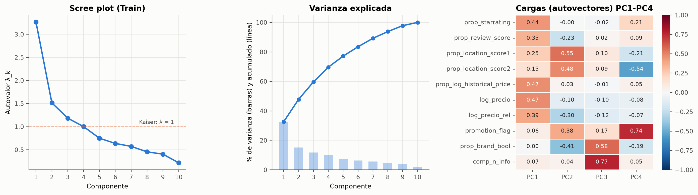{#fig-pca}

# Fase 3: torneo predictivo

Cuatro familias, misma partición y CV agrupada; PR-AUC como métrica de selección (prevalencia
≈ 2 %) y umbral elegido en Train por máximo F1.

```{python}
#| label: tbl-torneo
#| tbl-cap: "Desempeño en Test (umbral elegido en Train por máximo F1)."
t = pd.DataFrame(F3["test"]).T[["ROC_AUC", "PR_AUC", "Brier", "Precision", "Recall", "F1", "F1_macro", "F1_ponderado"]]
tabla(t.astype(float), 3)
```

- **Logística regularizada.** La grilla elige penalización `{python} F3["logit_params"]["logisticregression__penalty"].upper()`
  con $C$ = `{python} F3["logit_params"]["logisticregression__C"]`. Los odds ratios (@tbl-or) salen
  de una logística sin penalizar con errores por clúster de búsqueda; son **asociativos**, no
  causales.
- **Naive Bayes gaussiano.** Ordena aceptablemente (ROC-AUC `{python} n(F3["test"]["Naive Bayes"]["ROC_AUC"], 3)`)
  pero sus probabilidades son inutilizables (Brier `{python} n(F3["test"]["Naive Bayes"]["Brier"], 3)`):
  la independencia condicional $P(X \mid Y) = \prod_j P(X_j \mid Y)$ se viola (precio y precio
  histórico correlacionan dentro de cada clase), cuenta varias veces la misma evidencia y empuja las
  probabilidades a 0 o a 1 [@niculescu2005calibration].
- **CART.** Sin restricciones, el árbol (`{python} n(F3["arbol_libre"]["hojas"], 0)` hojas) memoriza
  Train (PR-AUC `{python} n(F3["arbol_libre"]["pr_auc_train"], 3)`) y fracasa en Test
  (`{python} n(F3["arbol_libre"]["pr_auc_test"], 3)`). Con poda por complejidad
  $R_\alpha(T) = R(T) + \alpha\lvert T \rvert$ y $\alpha_{\text{opt}}$ por CV queda en
  `{python} F3["arbol_podado"]["hojas"]` hojas y profundidad `{python} F3["arbol_podado"]["profundidad"]`;
  la regla raíz separa por posición.
- **Random Forest** [@breiman2001rf]. Búsqueda aleatoria sobre los cinco hiperparámetros
  (`n_estimators` = `{python} F3["rf_params"]["n_estimators"]`, `max_depth` =
  `{python} F3["rf_params"]["max_depth"]`, `min_samples_leaf` = `{python} F3["rf_params"]["min_samples_leaf"]`,
  `max_features` = `{python} F3["rf_params"]["max_features"]`). El error OOB (PR-AUC
  `{python} n(F3["oob_pr_auc"], 3)`) converge con la CV. Un holdout cronológico (último 20 % del
  período) da PR-AUC `{python} n(F3["cronologico"]["pr_auc"], 3)`, cerca del aleatorio.

```{python}
#| label: tbl-or
#| tbl-cap: "Odds ratios de la logística sin penalizar (Train, errores por clúster de búsqueda): las 12 variables con menor p-valor."
lo = pd.DataFrame(F3["logit_or"]).T[["OR", "IC95_inf", "IC95_sup", "p"]].astype(float)
lo["p"] = lo["p"].map(pv)
tabla(lo, 3)
```

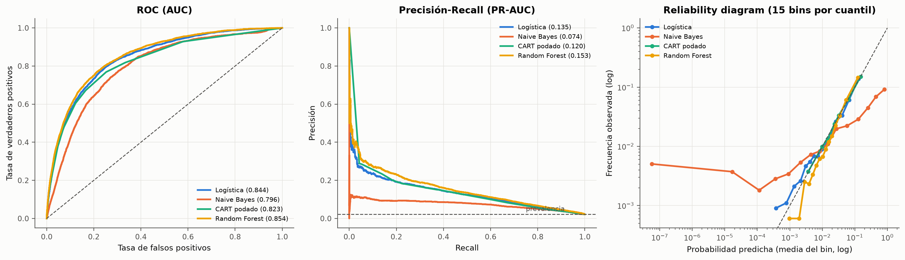{#fig-eval}

**MDI vs. permutación.** El MDI suma reducciones de impureza en cada split. Una variable continua
con muchos valores distintos ofrece muchos más cortes candidatos que una dummy, así que gana splits
por azar, sobre todo en nodos profundos con pocas observaciones, y acumula importancia aunque no
generalice [@strobl2007mdi]. Además se calcula en Train. La importancia por permutación mide cuánto
cae la PR-AUC **en Test** al romper la relación de una variable con $Y$, así que no premia los
cortes espurios. En nuestros datos, el MDI correlaciona con la cardinalidad de las variables
($\rho$ = `{python} n(F3["rho_cardinalidad_mdi"], 2)`); por permutación, la variable más importante
es `{python} top_perm` ($\Delta$PR-AUC = `{python} n(imp[top_perm]["Permutación (ΔPR-AUC)"], 3)`).

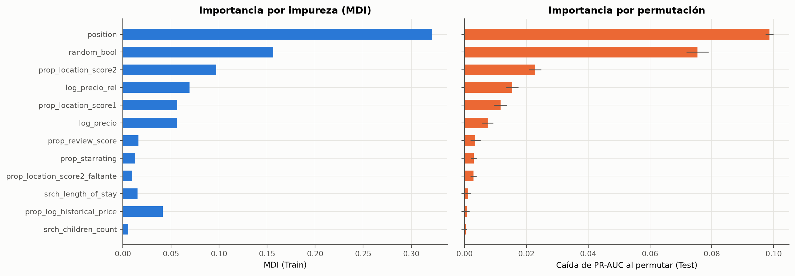{#fig-imp}

# Fase 4: inferencia causal

## DAG e identificación

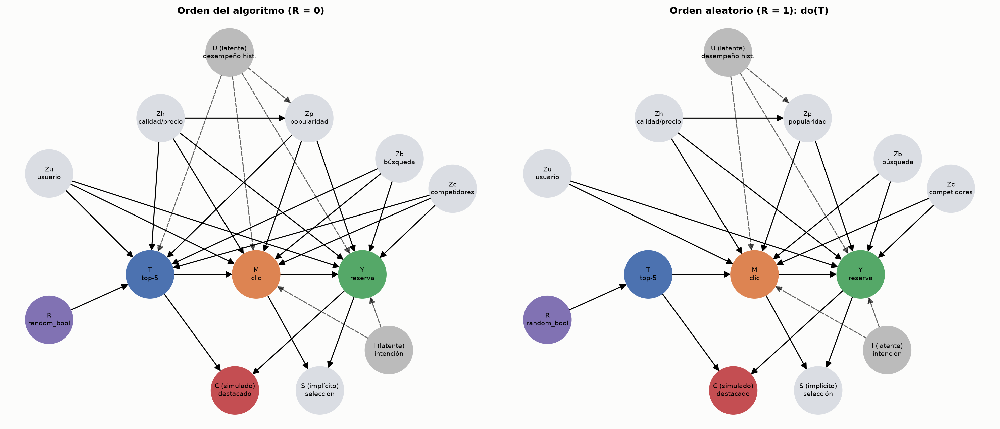{#fig-dag}

**Demostración Backdoor.** Con $R = 0$, todo camino trasero entre $T$ e $Y$ entra a $T$ por
$Z$ o por $U$. $Z$ bloquea los caminos $T \leftarrow Z \to Y$ y no abre ninguno nuevo: no contiene
colisionadores ni descendientes de $T$ (el clic $M$ y la selección $S$ quedan fuera del ajuste).
Pero $T \leftarrow U \to Y$ queda abierto: **Backdoor no se cumple si $U$ existe**. Con $R = 1$, la
cirugía de grafo elimina los arcos que entran a $T$ salvo $R \to T$ y el conjunto vacío alcanza. Lo
verifican 12 pruebas de d-separación (`tests/test_dag.py`).

## DoWhy en cuatro pasos

*Model* (`CausalModel` con el DAG y el clic como mediador) → *Identify* (`identify_effect`, Backdoor
con $Z$; DoWhy excluye el mediador) → *Estimate* (regresión lineal backdoor e IPW) → *Refute*
(@sec-refut) [@sharma2020dowhy].

```{python}
#| label: tbl-ate
#| tbl-cap: "Efecto del top-5 sobre P(reserva) en escala absoluta (DoWhy) y sesgo de confusión del ingenuo."
a = pd.DataFrame(F4["ate_dowhy"]).T[["ingenuo (Y ~ T)", "regresión backdoor", "IPW", "tasa base P(Y|T=0)", "sesgo de confusión (ingenuo − regresión)", "sesgo relativo %"]]
a.columns = ["ingenuo Y ~ T", "regresión backdoor", "IPW", "tasa base", "sesgo (ingenuo − regresión)", "sesgo (%)"]
tabla(a.astype(float), 4)
```

Con el orden del algoritmo, el coeficiente ingenuo de $Y \sim T$ supera al ajustado: el sesgo de
confusión es **positivo** (el algoritmo pone arriba a hoteles que se reservarían igual) y equivale al
`{python} n(F4["ate_dowhy"]["R = 0 (algoritmo)"]["sesgo relativo %"], 1)` % del efecto ajustado. Las
magnitudes absolutas **no** son comparables entre estratos, porque la selección del dataset infla
la tasa base del orden del algoritmo.

## Positividad y overlap {#sec-overlap}

```{python}
#| label: tbl-overlap
#| tbl-cap: "Diagnóstico de positividad: propensión estimada ê(z) por grupo, fracción fuera de [0,01; 0,99], peso máximo y tamaño efectivo de Kish."
ov = pd.DataFrame(OV)[["R = 0 (algoritmo)", "R = 1 (aleatorio)"]].loc[["ps_p01_T1", "ps_p99_T1", "ps_p01_T0", "ps_p99_T0", "pct_fuera_T1", "pct_fuera_T0", "peso_max", "ess_T1", "n_T1", "ess_T0", "n_T0"]]
ov.index = ["ê p1 (top-5)", "ê p99 (top-5)", "ê p1 (resto)", "ê p99 (resto)", "% fuera de [0,01; 0,99] (top-5)", "% fuera (resto)", "peso IPW máximo", "ESS top-5", "n top-5", "ESS resto", "n resto"]
tabla(ov.astype(float), 3)
```

El IPW identifica $\tau$ solo si se cumple la positividad [@rosenbaum1983propensity]. Las
propensiones del top-5 y del resto se superponen en todo su rango y casi ninguna unidad cae fuera de
$[0{,}01;\,0{,}99]$ (@tbl-overlap, @fig-overlap). El IPW de Hájek da
`{python} n(ipw0["ATE"], 4)` (IC 95 % bootstrap por búsqueda `{python} ic(ipw0["IC95_inf"], ipw0["IC95_sup"], 4)`),
y excluyendo las unidades sin overlap [@crump2009overlap], `{python} n(ipw0r["ATE"], 4)`
`{python} ic(ipw0r["IC95_inf"], ipw0r["IC95_sup"], 4)`: el recorte no cambia la estimación. El IC
fija la propensión estimada, lo que lo hace conservador [@hirano2003propensity]. **La positividad
no es el problema de este trabajo; $U$ sí**: ningún reponderado por lo observado corrige la
confusión que revela el benchmark.

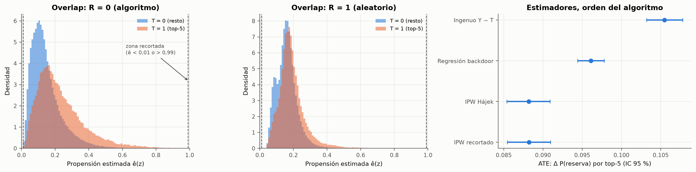{#fig-overlap}

## Escala relativa: observacional vs. cuasi-experimento

```{python}
#| label: tbl-or-intra
#| tbl-cap: "OR intra-búsqueda del top-5 (logit condicional, ecuación 2) y diferencia de probabilidad con efectos fijos (MPL-EF)."
o = pd.DataFrame(OR_TAB).T
o2 = pd.DataFrame({
    "OR intra": o["OR intra"].astype(float).map(lambda v: n(v, 3)),
    "IC 95 %": o["OR IC95"].map(lambda v: ic(*v, 3)),
    "búsquedas informativas": o["búsquedas informativas"].map(lambda v: n(v, 0)),
    "Δp (MPL-EF)": o["MPL-EF (Δp)"].astype(float).map(lambda v: n(v, 4)),
})
md(o2)
```

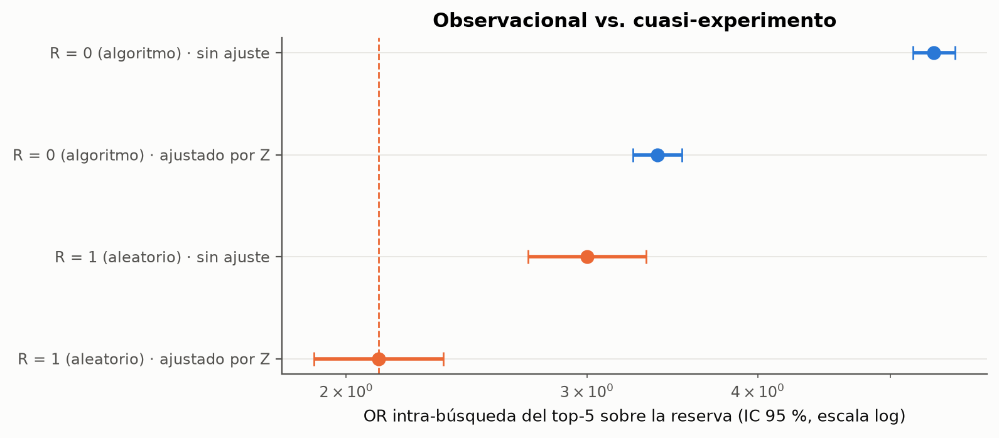{#fig-or}

La brecha entre el OR ingenuo del algoritmo y el benchmark es de `{python} n(F4["brecha_logor"], 3)`
en log-odds; el ajuste por $Z$ explica el `{python} n(F4["pct_explicado_Z"], 1)` %. El resto es
compatible con la confusión no observada $U$. La sensibilidad con $T$ = top-4 del dataset (los
slots fijos no publicados no cuentan) da OR = `{python} n(F4["sens_top4"]["or"], 3)`
`{python} ic(*F4["sens_top4"]["ic"], 3)`.

## Robustez de la conclusión central

La afirmación "el observacional ajustado sobreestima el efecto causal" se sometió a tres pruebas
(notebook, 4.3 bis), sobre las búsquedas con una reserva:

1. **Balance de poblaciones.** La mayor |SMD| entre búsquedas del algoritmo y aleatorias es
   `{python} n(R4["smd_max_sin_ponderar"], 3)`; con pesos de odds baja a
   `{python} n(R4["smd_max_ponderado"], 3)` (tamaño efectivo `{python} n(R4["ess"], 0)` de
   `{python} n(R4["n_R0"], 0)`). Re-ponderado, el cociente de OR es
   `{python} n(TR["R=0 ponderado a la composición de R=1"]["cociente OR"], 3)`: la brecha no es una
   diferencia de población.
2. **No colapsabilidad del OR.** En diferencia de riesgos (efecto marginal promedio del logit de
   elección), el top-5 suma `{python} n(TR["sin ponderar"]["AME R=0 (p.p.)"], 2)` p.p. con el
   algoritmo contra `{python} n(TR["sin ponderar"]["AME R=1 (p.p.)"], 2)` p.p. con orden aleatorio.
3. **Incertidumbre.** Wald de igualdad de log-OR: $z$ = `{python} n(TR["sin ponderar"]["Wald z"], 2)`,
   `{python} pv(TR["sin ponderar"]["p (Wald)"])`. Bootstrap percentil por búsqueda con
   `{python} R4["B"]` réplicas (@tbl-robustez): ninguna réplica muestra un cociente ≤ 1.

```{python}
#| label: tbl-robustez
#| tbl-cap: "Bootstrap por búsqueda (IC 95 % percentil): OR, efectos marginales (AME) y diferencia de riesgos con efectos fijos (DR-EF)."
b = pd.DataFrame(RB).T[["IC95_inf", "mediana", "IC95_sup"]].astype(float)
tabla(b, 4)
```

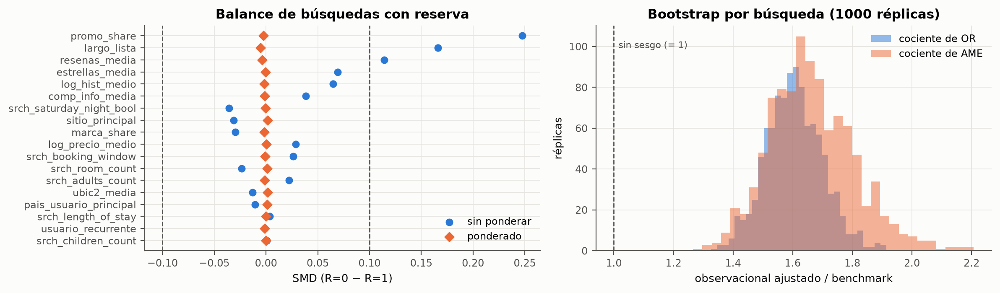{#fig-robustez}

## Mediador: el clic como paso del embudo

Reservar implica hacer clic, así que la identidad
$\mathrm{RR}_Y = \mathrm{RR}_{\text{clic}} \times \mathrm{RR}_{\text{conversión}\mid\text{clic}}$
descompone el efecto. Con orden aleatorio, $\mathrm{RR}_{\text{clic}}$ =
`{python} n(EMB["R = 1 (aleatorio)"]["RR clic"], 2)` `{python} EMB["R = 1 (aleatorio)"]["RR clic IC95"].replace(".", ",")`
y $\mathrm{RR}_{\text{conversión}\mid\text{clic}}$ =
`{python} n(EMB["R = 1 (aleatorio)"]["RR conversión|clic"], 2)` (descriptivo: condiciona en un
colisionador). El `{python} n(EMB["R = 1 (aleatorio)"]["% del log-RR vía clic"], 0)` % del efecto en
escala log opera a través de más clics.

**Trampa del mediador, demostrada.** Con el orden del algoritmo, el efecto total ajustado por $Z$ es
$\Delta p$ = `{python} n(F4["mediador"]["efecto total (ajuste Z)"]["Δp"], 4)`. Si además se ajusta
por el clic, cae a `{python} n(F4["mediador"]["ajustando además por el clic (M)"]["Δp"], 4)`: el
modelo concluye que la posición casi no importa, porque bloquea el canal por el que opera. Ajustar
por $M$ estima solo el efecto directo y subestima el impacto total de la política.

## Trampas de selección y del colisionador {#sec-trampas}

```{python}
#| label: tbl-trampas
#| tbl-cap: "Trampas demostradas: ajustar por el mediador, condicionar en la selección S y en el colisionador C."
m = pd.DataFrame(F4["mediador"]).T
m2 = pd.DataFrame({"Δp": m["Δp"].astype(float).map(lambda v: n(v, 4)), "IC 95 %": m["IC95"].map(lambda v: ic(*v, 4)), "p": m["p"].astype(float).map(pv)})
s_ = pd.DataFrame(F4["seleccion_sim"]).T
s2 = pd.DataFrame({"Δp": s_["Δp (MPL-EF)"].astype(float).map(lambda v: n(v, 4)), "IC 95 %": s_["Δp IC95"].map(lambda v: ic(*v, 4)), "p": "—"})
s2.index = ["simulación: " + i for i in s2.index]
c_ = pd.DataFrame(F4["colisionador_C"]).T
c2_ = pd.DataFrame({"Δp": c_["Δp ingenuo"].astype(float).map(lambda v: n(v, 4)), "IC 95 %": c_["Δp IC95"].map(lambda v: ic(*v, 4)), "p": "—"})
c2_.index = ["datos R = 1: " + i for i in c2_.index]
md(pd.concat([m2, s2, c2_]))
```

- **Colisionador natural (selección $S$).** En una simulación con verdad conocida, el OR
  intra-búsqueda se recupera igual con y sin el filtro "≥ 1 evento por lista"
  (`{python} n(F4["seleccion_sim"]["todas las listas"]["OR intra"], 3)` en ambos casos), mientras que
  la diferencia absoluta se duplica: por eso el estimando principal es relativo.
- **Colisionador simulado $C$** ($T \to C \leftarrow Y$). Condicionar en $C$ induce una asociación
  espuria (sesgo de Berkson): sobre los datos con orden aleatorio, la $\Delta p$ ingenua pasa de
  `{python} n(F4["colisionador_C"]["todas las filas (R = 1)"]["Δp ingenuo"], 4)` a
  `{python} n(F4["colisionador_C"]["condicionando en C = 1"]["Δp ingenuo"], 4)`, y en la simulación
  con verdad conocida el signo se invierte. La única regla segura es no condicionar.

## Refutaciones {#sec-refut}

```{python}
#| label: tbl-refut
#| tbl-cap: "Refutaciones de DoWhy sobre la regresión backdoor (orden del algoritmo)."
rf_ = pd.DataFrame(F4["refutaciones"]).T[["ATE original", "ATE refutado", "p", "pasa"]]
rf_["ATE original"] = rf_["ATE original"].astype(float).map(lambda v: n(v, 4))
rf_["ATE refutado"] = rf_["ATE refutado"].astype(float).map(lambda v: n(v, 4))
rf_["p"] = rf_["p"].astype(float).map(pv)
rf_["pasa"] = rf_["pasa"].map({True: "sí", False: "no"})
md(rf_)
```

- **Causa común aleatoria:** agregar al DAG una variable independiente no mueve el ATE: la
  estimación no depende de detalles accidentales del conjunto de ajuste.
- **Placebo:** con $T$ permutado, el ATE cae a ≈ 0 y no se rechaza que sea nulo: el efecto no es un
  artefacto del procedimiento.
- **Subconjunto del 80 %:** el ATE queda dentro del IC original: la estimación es estable.

Las tres miden **estabilidad**, no validez: no detectan la confusión por $U$. Esa la revela el
benchmark con orden aleatorio, que es la refutación más exigente del trabajo. La sensibilidad a un
$U$ simulado (notebook, 4.6) muestra que una confusión de fuerza moderada alcanza para anular el
efecto absoluto de $R = 0$.

## Double Machine Learning y CATE

DML [@chernozhukov2018dml] estima con modelos de ruido no lineales (Random Forest)
$\hat m(W, X) = \mathbb{E}[Y \mid W, X]$ y $\hat e(W, X) = P(T = 1 \mid W, X)$ con *cross-fitting*
por búsqueda, y regresa el residuo de $Y$ sobre el residuo de $T$:

$$
Y - \hat m(W, X) = \tau(X)\,\big(T - \hat e(W, X)\big) + \varepsilon .
$$ {#eq-dml}

La ortogonalidad de Neyman hace que los errores de $\hat m$ y $\hat e$ afecten a $\hat\tau$ solo en
segundo orden. `LinearDML` [@battocchi2019econml] estima un ATE de `{python} n(d0["ATE"], 4)`
`{python} ic(*d0["IC95"], 4)` con el orden del algoritmo y de `{python} n(d1["ATE"], 4)`
`{python} ic(*d1["IC95"], 4)` con orden aleatorio; relativos a sus tasas base, los cocientes son
`{python} n(d0["ATE"] / d0["tasa_base"], 2)` y `{python} n(d1["ATE"] / d1["tasa_base"], 2)`: el
mismo patrón de sobreestimación que el logit condicional.

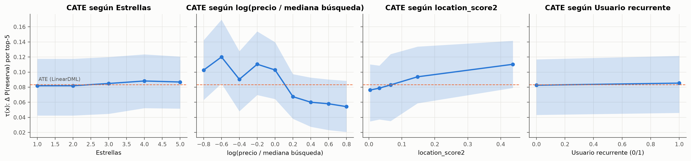{#fig-cate}

```{python}
#| label: tbl-het
#| tbl-cap: "Heterogeneidad con orden aleatorio: LinearDML, τ(x) = θ₀ + xᵀθ (R = 1)."
h = pd.DataFrame(F4["het_R1"]).T.astype(float)
h["p"] = h["p"].map(pv)
tabla(h, 4)
```

El Causal Forest [@wager2018causalforest; @athey2019grf] sobre los datos del algoritmo sugiere que
el slot rinde más para hoteles baratos para su búsqueda y bien ubicados (@fig-cate). La
heterogeneidad **se confirma con orden aleatorio**: los coeficientes del LinearDML de $R = 1$ tienen
el mismo signo (@tbl-het), así que no es un artefacto de $U$. @fig-cate-seg cuantifica el efecto
por segmento.

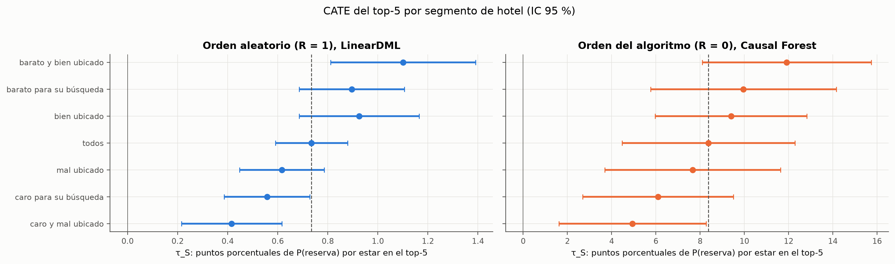{#fig-cate-seg}

# Ensayo crítico: capacidad predictiva vs. palanca causal

**¿Si la posición es la variable más importante del Random Forest, puede la dirección usarla como
palanca?** En la Fase 3, la posición es la variable con mayor importancia por permutación en Test y
la regla raíz del árbol podado. La tentación es leer el OR ingenuo (`{python} n(ori, 2)`) como lo que
gana un hotel al subirlo. La Fase 4 muestra por qué es un error.

1. **Gran parte de esa capacidad predictiva es selección, no causa.** El algoritmo pone arriba a los
   hoteles que se iban a reservar igual, por atributos que observamos y por un desempeño histórico
   que no. Para *predecir*, la posición es útil justamente porque resume todo eso. Para
   *intervenir*, solo cuenta el efecto que queda cuando la selección se rompe: el orden aleatorio da
   un OR de `{python} n(orb, 2)`.
2. **La palanca existe, pero es más chica y heterogénea.** Mover un hotel al top-5 sí aumenta sus
   reservas, y más si es barato para su búsqueda y está bien ubicado.
3. **Cuándo una variable muy predictiva no tiene poder causal, o tiene el signo opuesto:**
   - cuando es un **proxy de confusores** (la posición resume $U$);
   - cuando es **consecuencia del resultado o un colisionador** ($C$, o el clic si se condiciona en
     él): condicionar en $C$ puede invertir el signo del efecto;
   - cuando hay **selección de la muestra** sobre el resultado ($S$): `random_bool` es la segunda
     variable más predictiva del Random Forest y no es una palanca de negocio, sino la huella de
     cómo el proveedor seleccionó cada estrato.

   El mismo dato da tres respuestas distintas según qué se condiciona: el modelo que "controla" por
   el clic concluye que la posición no importa; el que condiciona en $C$, que perjudica; el que
   ajusta por $Z$ con el orden del algoritmo, que importa más de lo que importa.

**Conclusión del ensayo.** La importancia predictiva responde "¿qué variables ayudan a adivinar
$Y$?"; la palanca causal responde "¿qué pasa con $Y$ si muevo $X$?". Solo el DAG, la identificación
y, cuando existe, un experimento, permiten pasar de una a la otra [@pearl2009causality;
@hernan2020whatif].

# Recomendaciones de negocio cuantificadas

```{python}
#| label: tbl-escenarios
#| tbl-cap: "Valuación del slot por escenarios (por 1.000 exposiciones en el top-5; búsquedas con al menos un clic)."
e = pd.DataFrame(ESC).T[["Δp por exposición", "gasto por reserva (USD)", "desplazamiento de otra reserva", "reservas incrementales / 1.000", "USD incrementales / 1.000"]]
e.columns = ["Δp por exposición", "gasto por reserva (USD)", "fracción desplazada", "reservas / 1.000", "USD / 1.000"]
tabla(e.astype(float), 3)
```

```{python}
#| label: tbl-segmentos
#| tbl-cap: "Efecto causal por segmento con orden aleatorio (LinearDML, R = 1): reservas y USD incrementales por 1.000 exposiciones (gasto mediano, sin desplazamiento)."
g = pd.DataFrame(NEG).T[["reservas incrementales / 1.000", "IC95_inf reservas", "IC95_sup reservas", "USD incrementales / 1.000", "relativo a todos"]]
g.columns = ["reservas / 1.000", "IC 95 % inf.", "IC 95 % sup.", "USD / 1.000", "relativo a todos"]
tabla(g.astype(float), 2)
```

1. **Valuar el slot con el efecto causal, en un rango.** Cada 1.000 exposiciones en el top-5 valen
   entre `{python} n(ESC["conservador"]["USD incrementales / 1.000"], 0)` y
   `{python} n(ESC["optimista"]["USD incrementales / 1.000"], 0)` USD de gasto incremental
   (@tbl-escenarios), según el efecto supuesto, el gasto por reserva y cuánto de la reserva ganada se
   le quita a otro hotel de la lista. Sirve para ordenar decisiones y negociar contratos de
   posicionamiento, no para presupuestar: la escala absoluta depende de la selección del dataset.
2. **No pagar el sesgo.** Una valuación con datos del algoritmo, aun ajustada, sobrestima el OR del
   slot en `{python} pct(ora / orb - 1, 0)`. Un contrato de posicionamiento pago calculado así
   sobreprecia el inventario en esa proporción.
3. **Asignar la exposición por segmento.** El slot rinde
   `{python} n(NEG["barato y bien ubicado"]["relativo a todos"], 2)` veces el promedio con hoteles
   baratos para su búsqueda y bien ubicados, y `{python} n(NEG["caro y mal ubicado"]["relativo a todos"], 2)`
   veces con hoteles caros y mal ubicados (@tbl-segmentos). Reasignar 1.000 exposiciones del segundo
   grupo al primero suma `{python} n(REA["reservas_por_1000"], 2)` reservas incrementales, unos
   `{python} n(REA["usd_por_1000"], 0)` USD con el gasto mediano. Los IC 95 % de los dos segmentos
   extremos no se superponen entre sí
   (`{python} ic(NEG["barato y bien ubicado"]["IC95_inf reservas"], NEG["barato y bien ubicado"]["IC95_sup reservas"], 1)`
   contra `{python} ic(NEG["caro y mal ubicado"]["IC95_inf reservas"], NEG["caro y mal ubicado"]["IC95_sup reservas"], 1)`
   reservas por 1.000); los de los segmentos intermedios sí se superponen con el promedio, así que
   la recomendación se apoya en los extremos.
4. **Experimentar en forma continua.** El orden aleatorio fue la única fuente de verdad que permitió
   detectar el sesgo. Mantener una fracción chica de tráfico con orden aleatorio funciona como
   auditoría permanente del valor causal del ranking; su costo es la conversión que se pierde en ese
   tráfico, y su beneficio, no sobrepagar ni sobrevender el slot.
5. **Límites.** Todo vale para búsquedas con al menos un clic. Con slots de suma cero, el efecto
   neto para la plataforma es menor que la suma de efectos individuales (el escenario conservador
   supone que la mitad de las reservas ganadas son desplazadas).

# Limitaciones y amenazas a la validez

- **Validez interna.** (i) Aleatorización imperfecta: con $R = 1$ queda una asociación residual
  posición-atributos; se declara y se ajusta, sin forzar una explicación. (ii) Confusión por $U$ en
  $R = 0$: cuantificada por la brecha con el benchmark, no eliminada. (iii) SUTVA: el estimando es
  "efecto dada la competencia de la lista".
- **Validez externa.** La población es "búsquedas con al menos un clic" de 2012-2013; el efecto
  sobre el tráfico total no está identificado. La escala absoluta del estrato del algoritmo está
  inflada por el sobremuestreo de compras.
- **Validez de constructo.** $T$ se define sobre la posición en pantalla; la sensibilidad con el
  top-4 del dataset da el mismo OR.
- **Validez de la conclusión estadística.** Con $n$ grande todo es significativo: reportamos
  tamaños de efecto, MDE e IC bootstrap por búsqueda, no solo p-valores. Los IC de los CATE por
  segmento son anchos para los segmentos intermedios.
- **Confidencialidad.** Los resultados publicados podrían considerarse "model parameters" según las
  reglas de Kaggle: es un riesgo asumido y documentado (BITÁCORA, Entrada 1).

# Conclusiones

1. **El slot del top-5 tiene efecto causal positivo sobre la reserva**: con orden aleatorio, OR
   intra-búsqueda `{python} n(orb, 2)` `{python} ic(*ic_bench, 2)`. La exposición opera sobre todo a
   través de más clics.
2. **El dato observacional del algoritmo lo sobreestima aun después de ajustar** por todo lo
   observable (cociente de OR `{python} n(RB["cociente_OR"]["mediana"], 2)`, IC bootstrap que no
   incluye 1). El ajuste por $Z$ explica la mitad del sesgo; la otra mitad es confusión no
   observada. Backdoor con lo observable no alcanza en este sistema.
3. **El efecto es heterogéneo y la heterogeneidad es causal**: el slot rinde más con hoteles baratos
   para su búsqueda y bien ubicados, y el orden aleatorio lo confirma.
4. **La variable más predictiva no es una palanca de la misma magnitud.** Un modelo predictivo
   excelente puede recomendar políticas equivocadas si se lee como causal.
5. **Recomendación:** valuar y asignar el slot con el efecto causal por segmento y sostener una
   fracción de tráfico con orden aleatorio como auditoría.

# Referencias {.unnumbered}

::: {#refs}
:::



# Anexo A: uso de inteligencia artificial generativa {.appendix}

**Herramienta.** Claude Code [@anthropic2026claudecode], asistente de programación agéntico de
Anthropic (modelo Claude Opus 5.5), usado desde VS Code entre el 11 y el 13/11/2026.

**Cómo trabajamos con el agente.** El asistente trabajó dentro del repositorio con permisos para
leer y escribir archivos y ejecutar comandos (Python, `pytest`, `ruff`, Quarto, `git` y `gh`). Cada
fase empezó con un prompt de diseño de Verónica (Project Lead) que fijaba el objetivo, los criterios
de aceptación y lo que el asistente no podía decidir solo (datos, publicación, merges). El asistente
propuso el diseño, escribió el código, los tests, el notebook y los borradores; ejecutó todo
localmente y cerró cada fase con una lista de "qué revisar". Verónica revisó cada incremento, aprobó
o pidió cambios, y esas revisiones quedaron registradas como decisiones con autor. En la sesión de
cierre (13/11) el asistente trabajó en modo autónomo sobre una auditoría previa contra el enunciado
y la rúbrica (`docs/estado_cierre.md`).

**Prompts de diseño principales** (detalle en `docs/ia_log.md`):

1. Brief del TPI: leer enunciado y rúbrica, armar el repositorio, proponer datasets y roles, sin
   descargar datos antes de la aprobación.
2. Contrato de datos, test de `random_bool` y DAG borrador, todavía sin datos.
3. Descarga verificada, confidencialidad con mitigaciones testeadas y plan B listo para activar.
4. Un prompt por fase: diseño, ejecución, cierre con "qué revisar" y guía de defensa por rol.
5. Revisiones de Verónica que cambiaron el análisis: contrastar $Z_c \to T$ antes de llamarla
   confusor, transcribir las definiciones de Kaggle, y la revisión de robustez de la conclusión
   central (balance, diferencia de riesgos, bootstrap con 1000 réplicas, embudo del clic).
6. Prompt de cierre (13/11), transcripto en el recuadro de abajo como ejemplo.

**Errores y alucinaciones detectados.** El registro documenta 32 errores en las Fases 0-5 y los de
la sesión de cierre, cada uno con el test o la guarda que lo refuta o previene. Ejemplos:

| Error del asistente | Cómo se detectó | Test o guarda determinística |
|---|---|---|
| Afirmó de memoria que `random_bool` define un experimento puro | Verificación en los datos: la asociación posición-atributos persiste con $R = 1$ | `xfail` estricto en el test del contrato de datos |
| Traía de memoria el signo de `compN_rate` | Verónica transcribió la definición de Kaggle | Test del contrato sobre el dominio de `compN_inv` |
| RANSAC con el umbral por defecto (MAD de $Y$, no de los residuos) | Coeficientes inestables vs. MCO | Umbral corregido; Entrada 3 |
| Logit condicional sin converger, con un número plausible | Revisión de la salida del optimizador | Guarda que lanza error y test contra el Newton de statsmodels |
| Redactó un resultado antes de ver el output | Cotejo de cada número contra un output | Todo número del informe se lee de `resultados.json` |
| Imputación y winsorización ajustadas con toda la muestra (fuga Train/Test), detectado en la auditoría de cierre | Auditoría contra la regla "todo se ajusta en Train" | Test que perturba Test sobre la muestra real, más 4 tests `leakage` |
| Esperaba que truncar la propensión no sesgara el IPW | El test con verdad conocida falló | Test con verdad conocida: excluir no sesga, truncar sí |

**Declaración de alcance y auditoría humana.** El asistente escribió el código y los borradores de
texto; las decisiones de diseño, las aprobaciones y la revisión final son del equipo y constan con
autor en el registro. Ningún número de este informe se tomó del texto del asistente: todos salen de
`models/resultados.json`, que genera el notebook ejecutado de punta a punta. Los controles
automáticos (tests, guardas de convergencia, chequeo de confidencialidad) atraparon errores de
cómputo; las objeciones de fondo (comparabilidad de poblaciones, no colapsabilidad, incertidumbre de
un cociente, el clic como paso del embudo) vinieron de la revisión humana. Lucía y Antonella no
ejecutaron el trabajo técnico; sus roles se mantienen para la defensa oral, como declara la
BITÁCORA.

**Prompt de cierre (13/11/2026), texto completo.**

```{python}
#| output: asis
print("```text")
print(Path("../docs/prompt_cierre.md").read_text("utf-8").strip().replace("✅", "OK").replace("⚠️", "parcial").replace("❌", "falta"))
print("```")
```

# Anexo B: reproducibilidad y Quality Gate {.appendix}

- **Entorno.** Python 3.11; dependencias fijadas en `requirements.txt` (con el motivo de cada
  versión fijada) y `app/requirements.txt`; semilla global `SEED = 42` (`src/tpi/config.py`).
- **Datos.** `python data/download_data.py` descarga `data.zip` de Kaggle (requiere aceptar las
  reglas de la competencia), verifica hashes contra `data/manifiesto.json` y genera la muestra
  determinística. Ningún dato se versiona (`tests/test_confidencialidad.py`).
- **Ejecución.** `python -m nbconvert --to notebook --execute --inplace notebooks/TP_Integrador_Final.ipynb`
  regenera figuras, `models/resultados.json` y los artefactos de la app; `quarto render report/informe.qmd`
  regenera este informe.
- **Quality Gate (CI en cada PR):** `ruff check` y `ruff format --check` (PEP 8), tests de no-fuga
  (`pytest -m leakage`), la suite completa de `pytest` y la construcción de la imagen Docker de la
  app. El veredicto de QA (`[APROBADO]` o `[BLOQUEADO]`) se deja en cada PR antes del merge a `main`.
- **App.** `streamlit run app/app.py` o `docker build -t tpi-eaymr-app . && docker run -p 8501:8501 tpi-eaymr-app`;
  el enlace público del deploy figura en el README del repositorio.
