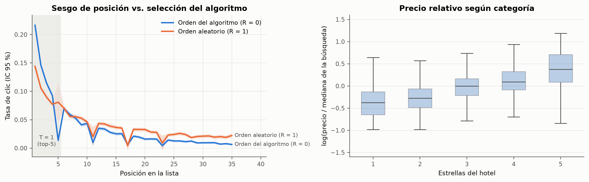
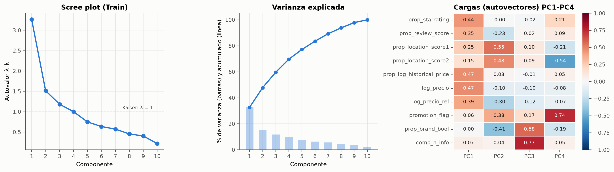
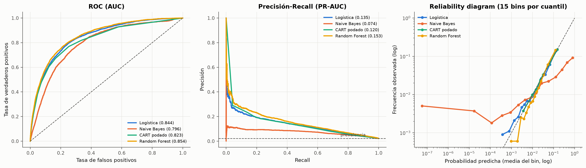
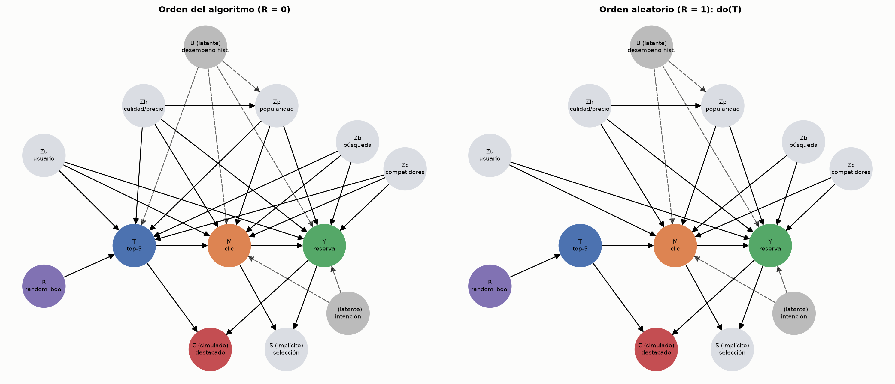
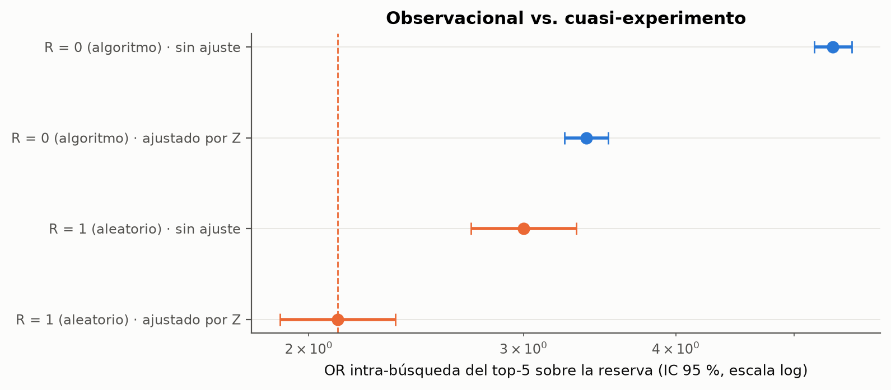
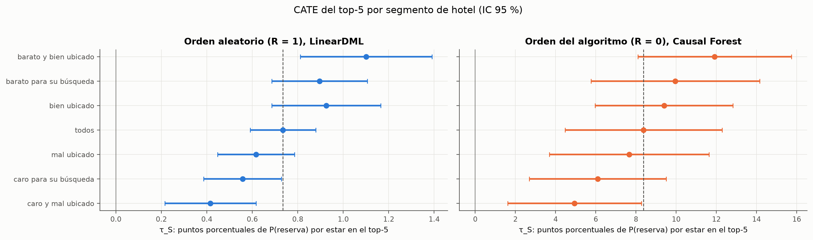

```{python}
import json
from pathlib import Path

R = json.loads(Path("../models/resultados.json").read_text("utf-8"))
F1, F2, F3, F4 = R["fase1"], R["fase2"], R["fase3"], R["fase4"]


def n(x, d=2):
    s = f"{x:,.{d}f}"
    return s.replace(",", "X").replace(".", ",").replace("X", ".")


def ic(lo, hi, d=2):
    return f"[{n(lo, d)}; {n(hi, d)}]"


orb, ora, ori = F4["or_benchmark"], F4["or_ajustado_R0"], F4["or_ingenuo_R0"]
ic_b = F4["or_intra"]["R = 1 (aleatorio) | ajustado por Z"]["OR IC95"]
RB = F4["robustez"]["bootstrap"]
mejor = F3["mejor"]
NEG, REA = F4["negocio_segmentos"], F4["reasignacion"]
ipw0 = F4["ipw"]["R = 0 (algoritmo) | IPW Hájek"]
ov0 = F4["overlap"]["R = 0 (algoritmo)"]
c1, an = F1["contraste1"], F1["anova"]
```

## 1 · El problema de negocio

- Unos 25 hoteles por búsqueda; la atención se concentra en los primeros. **Los slots del top son
  escasos y de suma cero.**
- El recomendador pone arriba hoteles que se venderían igual: ¿el slot **causa** ventas o solo las
  **predice**?
- La respuesta fija el precio de un slot premium y a quién conviene dárselo.
- **Preguntas:** efecto causal del top-5 sobre la reserva · sesgo del dato del algoritmo · rol del
  clic · para qué hoteles rinde más.

## 2 · Datos y experimento natural

- Expedia ICDM 2013 (Kaggle): `{python} n(R["fase0"]["filas_train_csv"], 0)` filas,
  `{python} n(R["fase0"]["busquedas_train_csv"], 0)` búsquedas; muestra de
  `{python} n(R["fase0"]["muestra_busquedas"], 0)` búsquedas completas.
- `random_bool`: parte de las búsquedas se mostró en **orden aleatorio** → benchmark para contrastar
  el supuesto Backdoor.
- Auditoría: centinelas, precio en dos escalas, slots fijos 5/11/17/23 fuera del dataset, dataset
  seleccionado sobre el clic (colisionador natural).
- Faltantes: MCAR se rechaza (Little: $d^2$ = `{python} n(F1["little"]["d2"], 0)`,
  `{python} F1["little"]["gl"]` gl). MAR → mediana por grupo **ajustada en Train** + indicador; MNAR
  estructural → no se imputa.

## 3 · Inferencia: el sesgo de posición existe

- Con orden aleatorio, la tasa de clic del top-5 es
  **`{python} n(c1["ctr_top5"] / c1["ctr_resto"], 2)` veces** la del resto ($t$ pareado, $d_z$ =
  `{python} n(c1["efecto"], 3)`; MDE $d_z$ = `{python} n(c1["mde_dz"], 3)`).
- ANOVA del log precio por estrellas: Levene rechaza → **Welch** $F$ = `{python} n(an["welch"]["valor"], 0)`,
  $\eta^2$ = `{python} n(an["welch"]["efecto"], 3)`; Kruskal y Games-Howell/Tukey/Bonferroni
  coinciden.
- Shapiro con $n$ grande rechaza ante desvíos irrelevantes: miramos asimetría, curtosis y Q-Q.
- Gasto: recurrentes vs. nuevos, **no se rechaza H0** (MDE $g$ = `{python} n(F1["contraste2"]["mde_g"], 3)`).

{height=36%}

## 4 · Gauss-Markov y PCA

- MCO del log precio: $R^2$ = `{python} n(F2["mco"]["r2"], 3)`. Breusch-Pagan rechaza → **HC3**;
  colas pesadas (curtosis `{python} n(F2["gauss_markov"]["curtosis"], 1)`) → **Huber**;
  Durbin-Watson = `{python} n(F2["gauss_markov"]["durbin_watson"], 2)`.
- `{python} F2["influencia"]["influyente_4n"]` influyentes ($D > 4/n$), ninguno con $D > 0,5$;
  VIF máx. `{python} n(F2["vif_max_ampliado"], 2)`.
- PCA **solo en Train**: PC1 = categoría-precio; PC2 = ubicación y promoción. Lo reservado se separa
  por PC2.

{height=40%}

## 5 · Torneo predictivo

```{python}
t = F3["test"]
```

- Logística L1/L2, Naive Bayes, CART podado ($\alpha$ por CV) y Random Forest (5 hiperparámetros,
  OOB $\approx$ CV); CV agrupada por búsqueda; PR-AUC como métrica (prevalencia $\approx$ 2 %).
- Ganador: **`{python} mejor`**, PR-AUC `{python} n(t[mejor]["PR_AUC"], 3)`, ROC-AUC
  `{python} n(t[mejor]["ROC_AUC"], 3)`, Brier `{python} n(t[mejor]["Brier"], 4)`. Holdout
  cronológico: `{python} n(F3["cronologico"]["pr_auc"], 3)`.
- Árbol sin poda: PR-AUC `{python} n(F3["arbol_libre"]["pr_auc_train"], 2)` en Train vs.
  `{python} n(F3["arbol_libre"]["pr_auc_test"], 3)` en Test → sobreajuste.
- Naive Bayes ordena (ROC-AUC `{python} n(t["Naive Bayes"]["ROC_AUC"], 3)`) pero sus probabilidades
  no sirven: la independencia condicional se viola.

## 6 · Calibración y explicabilidad

{height=44%}

- Reliability diagrams: logística, CART y RF calibrados; Naive Bayes empuja a 0 y 1.
- MDI favorece variables de alta cardinalidad ($\rho$ = `{python} n(F3["rho_cardinalidad_mdi"], 2)`);
  la permutación en Test lo corrige. **La posición es la variable más predictiva.**

## 7 · DAG, identificación y positividad

{height=46%}

- Con el algoritmo, $Z$ bloquea $T \leftarrow Z \to Y$ pero no $T \leftarrow U \to Y$. Con orden
  aleatorio, el conjunto vacío alcanza. Clic = mediador; selección $S$ y $C$ = colisionadores.
- Overlap: `{python} n(ov0["pct_fuera_T0"], 3)` % fuera de [0,01; 0,99]; IPW Hájek
  `{python} n(ipw0["ATE"], 4)` `{python} ic(ipw0["IC95_inf"], ipw0["IC95_sup"], 4)`, igual recortado.

## 8 · El efecto causal: observacional vs. cuasi-experimento

- OR intra-búsqueda (logit condicional): **benchmark `{python} n(orb, 2)`** `{python} ic(*ic_b)`,
  observacional ajustado `{python} n(ora, 2)`, ingenuo `{python} n(ori, 2)`.
- Ajustar por $Z$ explica el `{python} n(F4["pct_explicado_Z"], 0)` % del sesgo. **El ajuste por lo
  observable no alcanza**: cociente de OR `{python} n(RB["cociente_OR"]["mediana"], 2)`
  `{python} ic(RB["cociente_OR"]["IC95_inf"], RB["cociente_OR"]["IC95_sup"])` (bootstrap por
  búsqueda, `{python} F4["robustez"]["B"]` réplicas); se sostiene en diferencia de riesgos y
  re-ponderando.
- Trampas: ajustar por el clic deja $\Delta p$ $\approx$ `{python} n(F4["mediador"]["ajustando además por el clic (M)"]["Δp"], 4)`;
  condicionar en $C$ induce Berkson.

{height=30%}

## 9 · CATE por segmento y refutaciones

{height=46%}

- La heterogeneidad **se confirma con orden aleatorio** (LinearDML, R = 1): el efecto baja con el
  precio relativo y sube con la ubicación.
- Refutaciones (causa común aleatoria, placebo, subconjunto 80 %): las tres pasan. Miden
  estabilidad, no detectan $U$: eso lo hace el benchmark.

## 10 · Demo en vivo de la app

- **Diagnóstico + PCA:** filtros por estrato, distribuciones y proyección en PC1-PC2 (solo
  agregados).
- **What-Is:** probabilidad calibrada del Random Forest para un hotel nuevo, con explicación local.
- **What-If:** DAG, ATE, CATE según el perfil elegido y semáforo de las tres refutaciones.
- **Bonus:** copiloto con tool use sobre el motor causal y guardarraíl contra cifras inventadas.
- Enlace público en el README del repositorio; plan B: contenedor Docker probado.

## 11 · Conclusiones y recomendaciones

- **El top-5 causa reservas, pero menos de lo que muestran los datos del algoritmo**: valuar el slot
  con el efecto causal (el dato del algoritmo sobrevalúa el OR en
  `{python} n(100 * (ora / orb - 1), 0)` %).
- **Asignar por segmento:** `{python} n(NEG["barato y bien ubicado"]["reservas incrementales / 1.000"], 1)`
  reservas cada 1.000 exposiciones con hoteles baratos y bien ubicados vs.
  `{python} n(NEG["caro y mal ubicado"]["reservas incrementales / 1.000"], 1)` con caros y mal
  ubicados; reasignar suma $\approx$ `{python} n(REA["usd_por_1000"], 0)` USD cada 1.000.
- **Mantener tráfico con orden aleatorio** como auditoría permanente del ranking.
- La variable más predictiva **no es una palanca** de la misma magnitud.
- Límites: búsquedas con $\geq$ 1 clic, SUTVA (suma cero), aleatorización imperfecta, riesgo de licencia.

## 12 · Scrum, Quality Gate y bitácora

- Un sprint por fase, PR por fase con veredicto de QA `[APROBADO]` antes del merge a `main`.
- Quality Gate en CI: `ruff`, tests de no-fuga (`pytest -m leakage`), suite completa y build de
  la imagen Docker.
- Bitácora: 5 entradas firmadas por rol; **6 experimentos fallidos** documentados, entre ellos una
  fuga Train/Test en la imputación detectada en la auditoría de cierre y corregida.
- Uso de IA (Claude Code) trazado error por error, cada uno con el test que lo refuta.
